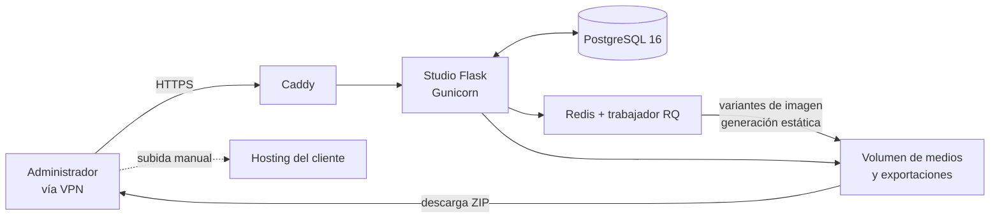

# Studio CMS – Etapa 1: Studio de uso personal

6 de octubre de 2026 · Javier · Documento de detalle de la etapa 1; el documento general es [requerimientos.md](requerimientos.md).

## 1. Objetivo y alcance

La etapa 1 entrega el Studio como herramienta de uso personal del administrador técnico: con él se construye un sitio completo (modelos, contenido, plantillas, diseño visual) y se exporta como sitio estático listo para subir a cualquier hosting. No hay clientes con acceso al Studio ni publicación automática.

**Resultado esperado al cerrar la etapa:** construir un sitio de ejemplo real (por ejemplo, el de la panadería del prototipo) de principio a fin en el Studio, exportarlo en ZIP y publicarlo a mano en un hosting sin modificar el código generado.

**Incluye**

- Acceso de un único administrador con doble factor y registro de auditoría.
- Gestión de varios sitios desde una misma instalación.
- Modelos de contenido, entradas con editor WYSIWYG y biblioteca de medios.
- Plantillas Jinja2 con editor de código (Monaco Editor) y versiones.
- Editor visual tipo lienzo (GrapesJS) con secciones apiladas, vistas por dispositivo, capas e inspector de clases y estilos.
- Diseños base, constructor de bloques y página de estilos del sitio.
- Rutas con SEO, vista previa del sitio completo y exportación estática en ZIP.

**No incluye (etapas posteriores)**

- Publicación automática al hosting, historial de publicaciones y reversión (etapa 2).
- Formularios y bandeja de envíos (etapa 2); los sitios exportados no tendrán formularios funcionales en esta etapa.
- Editores cliente, invitaciones, modo editor cliente y vista previa compartible (etapa 2).
- Secciones libres, guías y ajustes por dispositivo (etapa 2).
- Runtime, API REST y extensiones (etapas 3 y 4).

**Prototipo de referencia:** la carpeta [prototipo/](prototipo/README.md). Las pantallas de Publicación, Usuarios y la sección libre del editor visual corresponden a etapas posteriores.

## 2. Arquitectura y stack

En esta etapa todo corre en un solo servidor propio. El sitio sale del Studio únicamente como archivo ZIP que el administrador sube a mano al hosting del cliente.

Las tareas pesadas (variantes de imagen y generación del sitio) se ejecutan en segundo plano para que la interfaz no se bloquee.

| Capa | Tecnología | Uso en la etapa 1 |
| --- | --- | --- |
| Backend | Python 3.12, Flask con Blueprints (`auth`, `admin`, `preview`, `export`) | Lógica del Studio |
| ORM y migraciones | Flask-SQLAlchemy, Flask-Migrate (Alembic) | Esquema del Studio |
| Base de datos | PostgreSQL 16 | Datos, contenido en JSONB e índices GIN |
| Autenticación | Flask-Login, Argon2, TOTP con pyotp | Administrador con doble factor |
| Seguridad | Flask-WTF (CSRF), Flask-Limiter, nh3 | Formularios, inicio de sesión y sanitización de HTML |
| Tareas en segundo plano | RQ con Redis | Imágenes y exportación |
| Imágenes | Pillow | Variantes WebP |
| Motor de plantillas | Jinja2 con `SandboxedEnvironment` y cargador desde base de datos | Vista previa y exportación |
| Interfaz del Studio | Jinja2 + HTMX, JavaScript solo en editores | Panel |
| Editor de código | Monaco Editor con lenguaje Jinja2 propio | Plantillas |
| Editor visual | GrapesJS con componentes y plugins propios | Páginas, diseños base y bloques |
| Editor WYSIWYG | Tiptap | Campos de texto enriquecido |
| Despliegue | Docker Compose, Gunicorn, Caddy | Servidor propio con acceso por VPN o túnel |

## 3. Requerimientos funcionales: base y contenido

Los identificadores son los del documento general, para mantener la trazabilidad. Cada módulo indica los criterios de aceptación con que se dará por terminado.

### 3.1 Acceso y auditoría

| ID | Requerimiento |
| --- | --- |
| RF-01 | Iniciar sesión con correo, contraseña y doble factor (TOTP) obligatorio. |
| RF-03 | Registrar en auditoría toda creación, edición, eliminación y exportación. |

Criterios de aceptación:

- [ ] Sin un código TOTP válido no se accede a ninguna pantalla del Studio.
- [ ] Tras varios intentos fallidos seguidos, el inicio de sesión se bloquea temporalmente y queda registrado.
- [ ] Existen códigos de recuperación de un solo uso para el doble factor.
- [ ] Cada acción queda en el registro de auditoría con fecha, sitio, objeto y acción, visible desde el panel.

### 3.2 Sitios

| ID | Requerimiento |
| --- | --- |
| RF-04 | Crear, editar y archivar sitios, y cambiar el sitio activo desde el menú lateral. |

Criterios de aceptación:

- [ ] Un sitio tiene nombre, clave única y dominio previsto (usado en enlaces absolutos y en el sitemap).
- [ ] Todo lo que se crea queda asociado al sitio activo, y ninguna pantalla muestra datos de otro sitio.
- [ ] Un sitio archivado no aparece en el selector, pero se puede restaurar.

### 3.3 Modelos

| ID | Requerimiento |
| --- | --- |
| RF-05 | Crear modelos con nombre visible y nombre interno único por sitio. |
| RF-06 | Agregar, editar, reordenar y eliminar campos de tipo texto, texto enriquecido, número, fecha, booleano, imagen, slug y relación simple. |
| RF-07 | Configurar por campo: requerido, mínimo, máximo, valor por defecto y texto de ayuda. |
| RF-08 | Advertir antes de eliminar un campo con datos existentes. |

Criterios de aceptación:

- [ ] Cada cambio en un modelo actualiza su esquema JSON, visible en la pantalla del modelo.
- [ ] El slug se genera desde otro campo elegido y se valida como único dentro del modelo.
- [ ] Una relación apunta a otro modelo del mismo sitio y se muestra como selector en el formulario de la entrada.
- [ ] Eliminar un campo con datos muestra cuántas entradas lo usan y exige confirmación.

### 3.4 Contenido

| ID | Requerimiento |
| --- | --- |
| RF-09 | Listar, buscar y filtrar entradas por modelo y estado (borrador o listo para exportar). |
| RF-10 | Crear y editar entradas con un formulario generado desde el modelo, validado en el servidor. |
| RF-11 | Editar campos de texto enriquecido con editor WYSIWYG (negrita, cursiva, títulos, listas, enlaces, imágenes). |
| RF-12 | Mostrar en qué URL aparece cada entrada y su historial de versiones. |

Criterios de aceptación:

- [ ] El formulario de una entrada refleja de inmediato cualquier cambio del modelo.
- [ ] Los errores de validación se muestran junto a cada campo y no se pierde lo escrito.
- [ ] El HTML del editor enriquecido se sanitiza antes de guardarse.
- [ ] Cada guardado crea una versión, y se puede comparar y restaurar una versión anterior.
- [ ] Solo las entradas listas para exportar se incluyen en la vista previa pública y en el ZIP.

### 3.5 Medios

| ID | Requerimiento |
| --- | --- |
| RF-13 | Subir archivos por arrastrar y soltar, con validación de tipo real y tamaño máximo. |
| RF-14 | Generar variantes WebP de 320, 800 y 1600 px de ancho por imagen. |
| RF-15 | Registrar texto alternativo y dónde se usa cada archivo, e impedir eliminar archivos en uso. |

Criterios de aceptación:

- [ ] Un archivo con extensión válida pero contenido distinto es rechazado.
- [ ] Las variantes se generan en segundo plano y el archivo queda utilizable mientras tanto.
- [ ] La ficha del archivo lista las entradas y plantillas donde se usa.

## 4. Requerimientos funcionales: diseño y plantillas

Es el bloque más grande de la etapa. GrapesJS cubre el lienzo, las capas, el inspector y la paleta de bloques; el trabajo propio está en conectarlo con Jinja2, los modelos y los diseños base.

### 4.1 Plantillas por código

| ID | Requerimiento |
| --- | --- |
| RF-16 | Crear, editar y organizar plantillas Jinja2 en carpetas, con herencia y parciales. |
| RF-17 | Editar código con resaltado, autocompletado, detección de errores y vista previa con datos reales o de ejemplo. |
| RF-18 | Guardar versiones de cada plantilla y restaurar una versión anterior. |
| RF-19 | Definir el modo principal de cada plantilla (código o visual). |

Criterios de aceptación:

- [ ] Monaco resalta Jinja2 y HTML, y autocompleta las funciones y filtros del CMS (`entradas()`, `url_entrada()`, `media_url()`, `moneda`, `fecha`).
- [ ] Un error de sintaxis se muestra con su línea y no impide seguir editando; la plantilla con error no se puede guardar como versión activa.
- [ ] Las plantillas se ejecutan en sandbox: un intento de acceder a atributos internos de Python falla con un mensaje claro.
- [ ] Una plantilla en modo visual muestra su código generado como solo lectura.

### 4.2 Editor visual

| ID | Requerimiento |
| --- | --- |
| RF-20 | Componer páginas arrastrando bloques básicos: portada, texto, imagen, botón, columnas y espaciador. |
| RF-21 | Usar bloques dinámicos de lista y detalle de entradas, configurables por modelo, filtro, orden y límite. |
| RF-22 | Previsualizar en escritorio, tableta y móvil. |
| RF-60 | Navegar el editor como lienzo: zoom, desplazamiento y vistas por dispositivo. |
| RF-61 | Agregar, reordenar, duplicar y eliminar secciones, con panel de capas e historial para deshacer. |
| RF-62 | Editar las propiedades de contenido de cada sección con vista en vivo. |
| RF-63 | Inspeccionar cada sección: clases, alineación, relleno, margen, bordes, ancho, fondo, color, CSS adicional y CSS resultante. |

Criterios de aceptación:

- [ ] La página del editor muestra la cabecera y el pie heredados del diseño base, sin permitir editarlos ahí.
- [ ] Un bloque de lista muestra entradas reales del sitio y se actualiza al cambiar filtro o límite.
- [ ] Al guardar, la plantilla visual genera un Jinja2 válido que renderiza igual en la vista previa que en el editor.
- [ ] Deshacer revierte al menos los últimos 30 cambios de la sesión.
- [ ] Las clases del tema aparecen como sugerencias en el inspector, y las clases desconocidas se marcan como propias.

### 4.3 Diseños base y estilos del sitio

| ID | Requerimiento |
| --- | --- |
| RF-53 | Definir diseños base con regiones (aviso, cabecera, hero, contenido, barra lateral, pie) y generar la plantilla base con sus bloques `block`. |
| RF-54 | Configurar por región el ancho, el fondo y los bloques permitidos. |
| RF-55 | Definir el tema del sitio: colores, fondo, texto y tipografía. |
| RF-78 | Centralizar los estilos del sitio en una página con paleta, escala tipográfica y espaciados. |

Criterios de aceptación:

- [ ] Cambiar un color en la página de estilos actualiza el editor visual, la vista previa y la exportación sin tocar cada plantilla.
- [ ] Los estilos se exportan como variables CSS y clases utilitarias en una sola hoja de estilos del sitio.
- [ ] Una plantilla puede elegir su diseño base, y cambiarlo conserva el contenido de las regiones con el mismo nombre.

### 4.4 Constructor de bloques

| ID | Requerimiento |
| --- | --- |
| RF-24 | Crear bloques propios reutilizables a partir de plantillas parciales. |
| RF-56 | Definir nombre, clave, tipo (estático o dinámico), categoría, modelo de datos y modo (una entrada o lista). |
| RF-57 | Definir propiedades con tipo y valor por defecto, validando nombres y claves únicas. |
| RF-58 | Generar la plantilla del bloque desde sus propiedades o copiarla de un bloque existente, y editarla después. |
| RF-59 | Definir las regiones permitidas y el alcance (solo el sitio o global) de cada bloque. |

Criterios de aceptación:

- [ ] Un bloque nuevo aparece en la paleta del editor visual sin reiniciar el Studio.
- [ ] Sus propiedades se editan en el panel de contenido del editor, con el control que corresponde a cada tipo.
- [ ] Editar la plantilla de un bloque actualiza todas las páginas que lo usan.
- [ ] No se puede eliminar un bloque en uso; su ficha indica en qué plantillas aparece.

## 5. Requerimientos funcionales: rutas, vista previa y exportación

Esta parte convierte todo lo anterior en un sitio navegable y en el entregable de la etapa.

### 5.1 Rutas

| ID | Requerimiento |
| --- | --- |
| RF-25 | Asociar patrones de URL a una plantilla y a un tipo: página fija, lista o detalle de entrada. |
| RF-26 | Configurar título, meta descripción e inclusión en sitemap.xml por ruta. |

Criterios de aceptación:

- [ ] Una ruta de detalle (por ejemplo, `/productos/<slug>`) genera una página por cada entrada lista para exportar.
- [ ] Dos rutas no pueden resolver a la misma URL; el conflicto se avisa al guardar.
- [ ] El título y la meta descripción admiten campos de la entrada (por ejemplo, el nombre del producto).

### 5.2 Vista previa del sitio

| ID | Requerimiento |
| --- | --- |
| RF-84 | Previsualizar el sitio completo dentro del Studio, navegando entre páginas con datos reales. |

Criterios de aceptación:

- [ ] La vista previa usa el mismo motor y la misma hoja de estilos que la exportación, de modo que lo que se ve es lo que se exporta.
- [ ] Los enlaces internos funcionan dentro de la vista previa, y se puede alternar entre anchos de escritorio, tableta y móvil.
- [ ] La vista previa solo es accesible con la sesión del administrador.

### 5.3 Exportación estática

| ID | Requerimiento |
| --- | --- |
| RF-85 | Generar el sitio estático completo (HTML, CSS, imágenes y sitemap.xml) y descargarlo como archivo ZIP. |

Criterios de aceptación:

- [ ] Cada página se exporta como `ruta/index.html`, para que las URL limpias funcionen en cualquier servidor sin configuración.
- [ ] El ZIP incluye solo los medios usados, con sus variantes, y las rutas a archivos son relativas al dominio del sitio.
- [ ] Se generan `sitemap.xml`, `robots.txt` y una página 404.
- [ ] La exportación corre en segundo plano, muestra su avance y queda en un historial con fecha, tamaño y opción de descargar de nuevo.
- [ ] Antes de exportar se avisa de errores bloqueantes: plantillas con errores o rutas sin plantilla.

## 6. Requerimientos no funcionales

Aunque el Studio sea de uso personal, se construye con las mismas bases de seguridad que necesitará cuando entren clientes en la etapa 2, para no rehacerlas después.

| ID | Categoría | Requerimiento |
| --- | --- | --- |
| RNF-01 | Seguridad | Contraseñas con Argon2; sesiones con cookies seguras (HttpOnly, Secure, SameSite). |
| RNF-02 | Seguridad | Protección CSRF en todos los formularios y límite de intentos de inicio de sesión. |
| RNF-03 | Seguridad | Filtro por sitio aplicado automáticamente en la capa de consultas y cubierto por pruebas. |
| RNF-04 | Seguridad | Plantillas ejecutadas en el sandbox de Jinja2. |
| RNF-05 | Seguridad | HTML enriquecido sanitizado con lista blanca y política CSP en el Studio. |
| RNF-06 | Seguridad | Studio accesible solo por VPN o túnel con HTTPS, sin puertos abiertos a internet. |
| RNF-08 | Respaldos | Respaldo diario de PostgreSQL y medios, con 7 copias diarias y 4 semanales, y copia fuera del servidor. |
| RNF-09 | Respaldos | Prueba de restauración al menos una vez al mes. |
| RNF-11 | Rendimiento | Variantes de imagen y exportación en segundo plano; la interfaz no se bloquea. |
| RNF-12 | Rendimiento | Las pantallas del panel cargan sin esperas perceptibles; Monaco y GrapesJS se cargan solo en sus pantallas. |
| RNF-14 | Usabilidad | Interfaz en español, usable en tableta y con controles accesibles por teclado. |
| RNF-15 | Mantenibilidad | Pruebas automatizadas de modelos, filtro por sitio, renderizado de plantillas y exportación. |
| RNF-16 | Mantenibilidad | Registros de la aplicación y de los trabajos en segundo plano, consultables desde el servidor. |
| RNF-19 | Calidad del sitio exportado | HTML válido, imágenes con `srcset` y `alt`, y páginas sin dependencias externas obligatorias. |

## 7. Modelo de datos

Solo se crean las tablas que usa esta etapa. Las de publicación, formularios, clientes y API se agregan con migraciones en etapas posteriores; `site_id` está en todas las tablas de contenido desde el inicio.

| Tabla | Campos principales |
| --- | --- |
| `users` | id, email, password_hash, totp_secret, recovery_codes (hash), is_active, last_login_at |
| `sites` | id, name, key, domain, archived_at, created_at |
| `site_themes` | site_id, tokens (JSON: colores, tipografías, espaciados, utilidades) |
| `content_types` | id, site_id, name, key, schema (JSON), slug_source |
| `entries` | id, site_id, content_type_id, slug, data (JSONB), status (borrador o listo), updated_at |
| `entry_versions` | id, entry_id, data (JSONB), created_at |
| `media` | id, site_id, filename, mime, size, width, height, alt_text, variants (JSON) |
| `media_usages` | media_id, entry_id, template_id |
| `layouts` | id, site_id, path, name, regions (JSON: bloque, ancho, fondo, bloques permitidos) |
| `templates` | id, site_id, layout_id, path, source, mode (código o visual), visual_data (JSON) |
| `template_versions` | id, template_id, source, visual_data, created_at |
| `blocks` | id, site_id (nulo = global), key, name, kind, category, content_type_id, mode, props_schema (JSON), regions (JSON), template_id |
| `routes` | id, site_id, pattern, kind, content_type_id, lookup_field, template_id, seo (JSON), in_sitemap |
| `exports` | id, site_id, status, file_path, size, pages, warnings (JSON), created_at |
| `audit_log` | id, site_id, user_id, action, object_type, object_id, created_at |

En `entries.data` se crean índices GIN, y los campos usados en filtros de bloques de lista pueden tener índices de expresión.

## 8. Plan de trabajo y cierre

Los hitos siguen el orden de dependencias: primero lo que el resto necesita (acceso, datos, motor de plantillas) y al final el editor visual y la exportación, que integran todo. Cada hito termina con algo que se puede probar.

| Hito | Contenido | Entregable verificable | Requisitos (RF) |
| --- | --- | --- | --- |
| H1 · Base | Proyecto, Docker Compose, PostgreSQL, Redis, acceso con doble factor, sitios, auditoría y panel | Iniciar sesión, crear dos sitios y ver la auditoría | 01, 03, 04 |
| H2 · Modelos y contenido | Constructor de modelos con JSON Schema, formularios generados, Tiptap y versiones | Crear el modelo Producto y cargar entradas | 05 a 12 |
| H3 · Medios | Carga, validación, variantes WebP y registro de uso | Subir imágenes y usarlas en entradas | 13 a 15 |
| H4 · Motor de plantillas | Cargador desde base de datos, sandbox, funciones del CMS, Monaco con Jinja2 y versiones | Una plantilla por código lista productos reales | 16 a 19 |
| H5 · Rutas y vista previa | Rutas, SEO y navegación del sitio dentro del Studio | Navegar el sitio de ejemplo en la vista previa | 25, 26, 84 |
| H6 · Diseños base y estilos | Regiones, plantilla base generada, página de estilos y hoja CSS del sitio | Cambiar un color y verlo en todo el sitio | 53 a 55, 78 |
| H7 · Editor visual | GrapesJS, bloques básicos y dinámicos, dispositivos, capas, inspector y exportación a Jinja2 | Armar la portada solo con el editor visual | 20 a 22, 60 a 63 |
| H8 · Constructor de bloques | Creación de bloques, propiedades, plantilla generada y alcance | Crear «Tarjeta de producto» y usarla en una página | 24, 56 a 59 |
| H9 · Exportación y cierre | Generación estática, ZIP, historial, pruebas finales y respaldos | Publicar a mano el sitio de ejemplo exportado | 85 |

**Criterios de cierre de la etapa**

- [ ] Todos los criterios de aceptación de las secciones 3, 4 y 5 están cumplidos.
- [ ] El sitio de ejemplo se construye completo en el Studio, se exporta y funciona en un hosting real sin editar el código generado.
- [ ] Las pruebas automatizadas del filtro por sitio, el renderizado y la exportación pasan.
- [ ] Se hizo al menos una restauración de prueba desde el respaldo externo.
- [ ] El documento general refleja cualquier cambio de alcance decidido durante la etapa.

## 9. Riesgos, supuestos y decisiones pendientes

El hito H7 concentra la mayor incertidumbre técnica, por eso conviene hacer una prueba de concepto de GrapesJS con Jinja2 antes de terminar H4.

**Supuestos**

- El Studio lo usa una sola persona, desde su red o por VPN.
- Los sitios exportados se suben manualmente al hosting del cliente.
- Los sitios de esta etapa no necesitan formularios ni contenido dinámico en el servidor.

**Riesgos**

| Riesgo | Impacto | Mitigación |
| --- | --- | --- |
| Integrar GrapesJS con plantillas Jinja2 y bloques dinámicos | Alto | Prueba de concepto temprana: un bloque de lista que genere un `for` válido y se vea igual en el editor y en la vista previa. |
| Crecimiento del alcance durante la etapa | Alto | Todo lo nuevo se anota para la etapa 2, salvo que bloquee el sitio de ejemplo. |
| Lenguaje Jinja2 para Monaco | Medio | Partir de la definición de Twig y agregar solo las funciones del CMS. |
| Diferencias entre vista previa y exportación | Medio | Un único motor de renderizado para ambas, con pruebas que comparan el HTML generado. |
| Pérdida de datos en el servidor propio | Medio | Respaldo diario con copia externa y prueba de restauración mensual. |

**Decisiones pendientes para esta etapa**

- [ ] Confirmar Jinja2 + HTMX para la interfaz del panel.
- [ ] Dónde se guarda la copia externa de los respaldos.
- [ ] Qué sitio real se usará como sitio de ejemplo para validar el cierre.
- [ ] Si el historial de exportaciones guarda todos los ZIP o solo los últimos.
