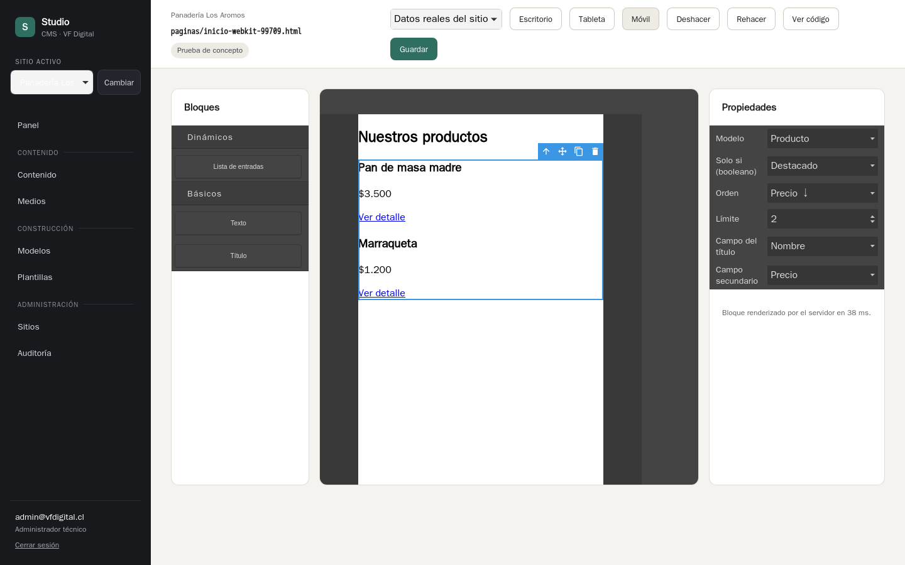

# Prueba de concepto: GrapesJS con Jinja2

Responde el riesgo principal de `docs/etapa-1.md` §9: si un bloque de GrapesJS puede generar un `` válido sobre `entradas()` y verse igual en el editor que en la vista previa. El código está en la rama `poc/grapesjs-jinja`, que no se mezcla con `main`. Este documento es lo que H7 toma de ella.

**Resultado: el enfoque funciona.** Se cumplieron los seis criterios en Chromium y WebKit (el motor de Safari). Salieron cinco ajustes que H7 debe incorporar desde el inicio (ver «Recomendaciones para H7»).

## Qué se construyó

- **Componente propio `cms-lista`.** Sus propiedades editables (*traits* de GrapesJS) son el modelo, el filtro booleano, el orden, el límite, el campo del título y el campo secundario. Las opciones salen de los modelos del sitio, y el código solo usa claves de campos que existen.
- **Exportación directa a Jinja2** en el método `toHTML()` del componente:
  ```jinja
  <section class="cms-lista">
  
  <article class="cms-lista__item">
  <h3>{{ p.nombre }}</h3>
  <p>{{ p.precio | moneda }}</p>
  <a href="{{ url_entrada(p) }}">Ver detalle</a>
  </article>
  
  </section>
  ```
- **El lienzo no imita el resultado.** La vista del componente envía ese mismo Jinja a `POST /plantillas/fragmento`, y esa ruta lo renderiza con el motor de H4 (`engine.render`). Por eso el lienzo y la vista previa no pueden diferir: los produce el mismo código, como pide la regla de un solo motor.
- **Guardar:** `engine.check()` valida el Jinja exportado y luego se guarda como `source` de la plantilla, en modo visual. La pantalla de H4 lo muestra de solo lectura. El árbol de GrapesJS se guardó en `localStorage`; en H7 va a `templates.visual_data`.
- **Bloques estáticos** de título y texto, para comprobar que conviven con el dinámico.

## Resultados

| # | Criterio | Chromium | WebKit | Cómo se comprobó |
| --- | --- | --- | --- | --- |
| 1 | El `` generado es Jinja2 válido | ✔ | ✔ | `engine.check()` al guardar y `tests/test_poc_grapes.py` |
| 2 | Se ve igual en el editor y en la vista previa | ✔ | ✔ | El HTML del bloque en el lienzo es idéntico (con espacios normalizados) al de la vista previa, con datos reales y con datos de ejemplo |
| 3 | Muestra entradas reales y se actualiza al cambiar el límite | ✔ | ✔ | Límite de 3 a 2 desde el panel de propiedades: el lienzo pasa de 3 a 2 tarjetas |
| 4 | Deshacer revierte 30 cambios | ✔ | ✔ | 30 cambios de límite seguidos de 30 «deshacer» vuelven al valor inicial (pila configurada en 100) |
| 5 | Funciona en Safari | ✔ | ✔ | Todos los chequeos en WebKit con Playwright |
| 6 | Compatible con la CSP del Studio | ✔ | ✔* | Sin errores de CSP tras los ajustes de la sección siguiente |

\* En una de cinco corridas, WebKit registró dos veces «Refused to apply a stylesheet». No se volvió a producir en las cuatro siguientes. Hay que vigilarlo en H7.

Además:
- **Arrastrar** el bloque desde el panel al lienzo funciona en los dos navegadores, con un arrastre real del mouse. El `dragTo` de Playwright no sirve para el arrastre HTML5 hacia el `iframe` del lienzo, pero es una limitación de la herramienta de pruebas.
- **Dispositivos:** escritorio, tableta (768 px) y móvil (390 px) con el Device Manager de GrapesJS.
- **Tiempos:** el bloque tarda entre 25 y 40 ms en renderizarse en el servidor. La primera petición, con el motor en frío, tardó unos 260 ms.



## Hallazgos

1. **GrapesJS 0.23.7 se publicó roto en npm** el 13-10-2026: le faltan los archivos JavaScript (911 KB en vez de 12 MB). Se usó **0.23.6**. H7 debe fijar la versión exacta y revisar las nuevas antes de subir.
2. **Por defecto GrapesJS carga Font Awesome desde un CDN y envía telemetría** a `app.grapesjs.com`. La CSP lo bloqueó, pero hay que apagarlo con `cssIcons: ""` y `telemetry: false`. `CLAUDE.md` exige que nada se cargue desde un CDN. Sin Font Awesome, los bloques muestran su etiqueta pero no el ícono, así que H7 necesita sus propios íconos.
3. **CSP:** el lienzo inserta estilos en línea. La pantalla del editor visual necesita `style-src 'self' 'unsafe-inline'`, igual que Monaco. No requiere `unsafe-eval` ni permisos de scripts.
4. **Renders cruzados:** cambiar varias propiedades a la vez (un `set()` con seis) disparaba seis peticiones en paralelo. Si una respuesta vieja llegaba al final, dejaba el lienzo desactualizado. Se resolvió con un retardo de 150 ms y un número de secuencia: solo se pinta la última respuesta.
5. **El texto estático no se escapa.** Si el usuario escribe `{{ 2 * 1000 }}` o `` en un bloque de texto, GrapesJS lo exporta tal cual: Jinja lo ejecuta o la plantilla no se puede guardar. No es un riesgo de seguridad, porque todo corre en el sandbox, pero es un error para el usuario.
6. **Deshacer agrupa** los cambios hechos en el mismo ciclo de ejecución. Para una persona no se nota, porque cada cambio es un evento aparte, pero los cambios programáticos en bloque cuentan como uno solo.
7. **El lienzo de GrapesJS tiene dos `iframe`.** El de las páginas es `.gjs-frame`. Hay que tenerlo en cuenta en las pruebas automatizadas.
8. **Peso:** el bundle de GrapesJS pesa 1,1 MB de JS y 58 KB de CSS (minificados, sin comprimir). Se carga solo en el editor visual.

## Recomendaciones para H7

1. **Mantener el enfoque:** bloques dinámicos como componentes propios que exportan Jinja en `toHTML()` y se pintan con el motor del servidor. Es lo que garantiza que el editor, la vista previa y la exportación coincidan.
2. **Escapar el contenido estático al exportar.** Los nodos de texto y los atributos de los bloques estáticos no deben producir `{{`, `{%` ni `{#` interpretables: hay que escribirlos como entidades HTML o envolverlos en ``. Agregar una prueba que lo cubra.
3. **Configuración base del editor:** `cssIcons: ""`, `telemetry: false`, `storageManager` hacia `templates.visual_data`, `undoManager.maximumStackLength` de 100 o más, y la versión de `grapesjs` fijada.
4. **Renders con retardo y secuencia** en todos los bloques dinámicos, como en la prueba.
5. **Las opciones de los bloques vienen del servidor** (modelos y campos), y el Jinja se arma solo con claves conocidas, nunca con texto libre en las expresiones.

## Cómo reproducir

```bash
git switch poc/grapesjs-jinja
cd frontend && npm ci && npm run build && cd ..
uv run --env-file .env pytest tests/test_poc_grapes.py
uv run --env-file .env flask --app app run --debug
# En una plantilla: «Editor visual (prueba)»
```
