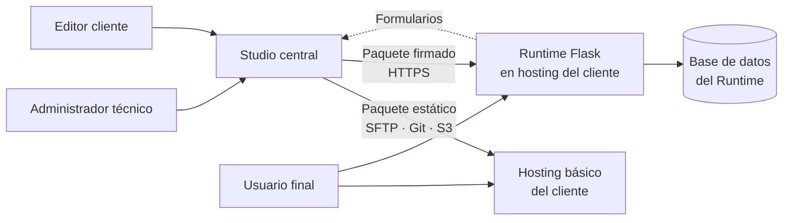
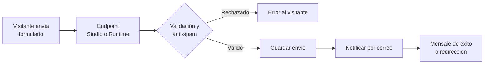
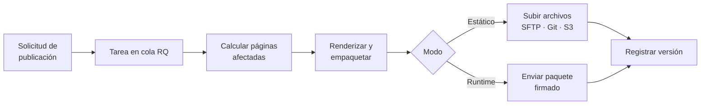

# Studio CMS – Requerimientos y especificación técnica

23 de septiembre de 2026 · Javier

## 1. Introducción

Studio CMS es un sistema de gestión de contenidos desarrollado desde cero en Flask para construir, editar y publicar sitios y aplicaciones web de clientes de VF Digital. Un único Studio central gestiona varios sitios, y cada sitio se publica en el hosting propio del cliente.

**Objetivos**

- Definir modelos de datos desde un panel, sin programar.
- Editar vistas HTML tanto por código (Jinja2) como de forma visual con arrastrar y soltar.
- Permitir que clientes no técnicos editen su contenido sin romper el diseño.
- Publicar cada sitio en infraestructura independiente, como sitio estático o como aplicación.

**Glosario**

| Término | Definición |
| --- | --- |
| Studio | Aplicación central donde se definen modelos, plantillas, rutas y contenido, y desde donde se publica. |
| Runtime | Aplicación Flask liviana instalada en el hosting del cliente que ejecuta las partes dinámicas de un sitio. |
| Sitio | Proyecto de un cliente dentro del Studio, con sus propios modelos, plantillas, contenido y destino de publicación. |
| Modelo | Tipo de contenido definido en el panel (por ejemplo, Producto), con sus campos y validaciones. |
| Entrada | Registro de un modelo (por ejemplo, el producto «Pan de masa madre»). |
| Plantilla | Vista Jinja2 almacenada en la base de datos, editable por código o visualmente. |
| Diseño base | Plantilla de estructura general (regiones como cabecera, contenido y pie) que heredan las demás plantillas. |
| Bloque | Componente reutilizable del editor visual; puede ser estático o dinámico (conectado a un modelo). |
| Sección libre | Sección del editor visual donde los elementos se ubican con posición y tamaño libres. |
| Guía | Línea de referencia para alinear elementos: automática (inteligente) o definida por el usuario. |
| Tema del sitio | Conjunto de colores, tipografías y espaciados que comparten las plantillas y bloques de un sitio. |
| Paquete | Conjunto versionado de archivos que el Studio genera y envía al destino en cada publicación. |
| Clave de API | Credencial con permisos acotados para consultar o modificar datos de un sitio mediante la API REST. |

## 2. Arquitectura general

El sistema es un CMS desacoplado: el Studio central construye y publica, y cada sitio se sirve desde el hosting del cliente. La sincronización es en un solo sentido, del Studio hacia el destino.



El administrador y los editores trabajan en el Studio; los usuarios finales solo interactúan con el sitio publicado.

**Responsabilidades**

| Componente | Responsabilidad | Datos que contiene |
| --- | --- | --- |
| Studio | Modelos, plantillas, editor visual, rutas, contenido, medios, usuarios del Studio y publicación. | Definiciones, contenido editorial, medios, historial de versiones. |
| Runtime | Servir páginas, ejecutar módulos dinámicos, autenticar usuarios finales, panel de datos de la aplicación. | Datos generados por usuarios finales (reservas, pedidos, registros). |
| Destino estático | Servir archivos HTML, CSS, JS e imágenes. | Solo archivos publicados. |

**Modos de publicación**

- **Estático:** el Studio renderiza las plantillas y envía archivos al hosting. Funciona en cualquier hosting y no depende de que el Studio esté disponible.
- **Runtime:** el Studio envía un paquete versionado (esquema, plantillas, rutas, recursos y configuración) al Runtime, que aplica migraciones y sirve el sitio. Requiere hosting con Python.

**Contenido frente a datos de aplicación:** el contenido editorial se gestiona en el Studio y se publica. Los datos que generan los usuarios finales viven solo en la base de datos del Runtime y nunca pasan por el Studio.

## 3. Roles y usuarios

El Studio tiene dos roles; el Runtime suma un tercer tipo de usuario, independiente del Studio.

| Rol | Dónde opera | Alcance |
| --- | --- | --- |
| Administrador técnico | Studio | Todos los sitios. Define modelos, plantillas, rutas, bloques, destinos de publicación, usuarios y sitios. Único usuario en la etapa 1. |
| Editor cliente | Studio | Solo su sitio. Edita contenido y medios, y usa el editor visual con los bloques y permisos que el administrador habilite (etapa 2). |
| Usuario final | Runtime | Solo el sitio publicado. Se registra, inicia sesión y usa los módulos dinámicos (etapa 3). |

**Matriz de permisos del Studio**

| Módulo | Administrador técnico | Editor cliente |
| --- | --- | --- |
| Contenido | Completo | Completo |
| Medios | Completo | Completo |
| Formularios | Completo | Ver y exportar envíos; editar textos y destinatarios |
| Editor visual | Completo | Solo bloques y regiones permitidos |
| Bloques | Completo | Usar los bloques visibles; sin crear ni editar |
| Diseños base y tema | Completo | Sin acceso |
| Plantillas por código | Completo | Sin acceso |
| Modelos | Completo | Sin acceso |
| Rutas | Completo | Sin acceso |
| Publicación | Completo | Publicar contenido |
| Vista previa y aprobación | Completo | Comentar y aprobar |
| API REST | Completo | Sin acceso |
| Usuarios y sitios | Completo | Sin acceso |

## 4. Alcance por etapas

El desarrollo se divide en cuatro etapas. La etapa 1 se limita al Studio como herramienta de uso personal del administrador: permite construir sitios completos y exportarlos, sin publicación automática ni acceso de clientes.

**Etapa 1: Studio de uso personal**

- Un solo usuario administrador con doble factor, gestión de varios sitios y registro de auditoría.
- Constructor de modelos, entradas con editor WYSIWYG y biblioteca de medios.
- Plantillas Jinja2 en la base de datos con editor de código (Monaco Editor).
- Editor visual tipo lienzo (GrapesJS) con secciones apiladas, vistas por dispositivo, capas e inspector de clases y estilos.
- Diseños base, constructor de bloques y página de estilos del sitio.
- Rutas configurables con SEO por ruta.
- Vista previa del sitio completo y generación estática con exportación en un archivo ZIP.

**Etapa 2: Publicación y trabajo con clientes**

- Publicación automática al hosting del cliente (SFTP, FTP, Git o S3), con historial y reversión.
- Constructor de formularios con receptor externo, bandeja de envíos, notificaciones por correo y protección anti-spam.
- Rol de editor cliente, modo editor cliente y acceso seguro al Studio (VPN o túnel con HTTPS).
- Vista previa compartible con aprobación del cliente y revisión antes de publicar.
- Kits de inicio por rubro y clonación de sitios.
- Secciones libres con guías, columnas, alineación y ajustes por dispositivo.

**Etapa 3: Runtime y API de lectura**

- Runtime Flask con PostgreSQL instalable en el hosting del cliente, con paquetes versionados y migraciones de esquema.
- Módulos configurables: formularios avanzados (lógica condicional y varios pasos), autenticación de usuarios finales, CRUD con permisos, listados con filtros y notificaciones.
- Panel de administración del Runtime generado a partir de los modelos.
- API REST de lectura con claves, documentación OpenAPI y límites de uso.

**Etapa 4: Lógica avanzada**

- Extensiones en Python para lógica de negocio personalizada, escritas solo por el administrador técnico.
- API REST de escritura, permisos por campo, versionado, endpoints personalizados y webhooks (incluidos los de formularios).
- Automatizaciones o flujos de trabajo y multilenguaje, según necesidades de clientes reales.

**Fuera de alcance (etapas 1 a 3)**

- Tienda en línea y pagos.
- Multilenguaje.
- Marketplace de plugins o temas.
- Flujos de aprobación editorial con varios niveles (la aprobación simple del cliente sí está en la etapa 2).
- Lógica de negocio arbitraria definida sin código.

### 4.1 Estado del prototipo

El [prototipo interactivo de la interfaz](https://claude.ai/artifact/HodLJRjZN5nKdiibmrQq1t) valida la experiencia de uso; ningún módulo está desarrollado todavía en Flask. «Implementado» significa que la pantalla existe y es navegable con datos de ejemplo.

| Módulo | Prototipo | Etapa de desarrollo | Alcance del prototipo |
| --- | --- | --- | --- |
| Panel | Implementado | 1 | Resumen del sitio, lista de sitios, estado de publicación y actividad reciente. |
| Navegación | Implementado | 1 | Barra lateral agrupada en Contenido, Construcción y Administración. |
| Modelos | Implementado | 1 | Campos por modelo, edición de campo, esquema JSON generado y vínculos a entradas y rutas. |
| Contenido | Implementado | 1 | Formulario generado desde el modelo, editor WYSIWYG y estructura del modelo visible. |
| Medios | Implementado | 1 | Biblioteca, carga, variantes WebP y uso de cada archivo. |
| Plantillas por código | Implementado | 1 | Árbol de archivos, editor Jinja2 y vista previa. |
| Editor visual (lienzo) | Implementado | 1 | Arrastrar y soltar, marcos de escritorio, tableta y móvil, zoom, capas y deshacer. |
| Inspector de clases y estilos | Implementado | 1 | Clases utilitarias y propias, estilos visuales, CSS adicional y CSS generado. |
| Diseños base | Implementado | 1 | Regiones, código generado, propiedades por región y tema del sitio. |
| Constructor de bloques | Implementado | 1 | Formulario de creación con validación y plantilla generada; edición posterior de propiedades pendiente. |
| Rutas | Implementado | 1 | Patrones de URL, tipos, plantillas y SEO por ruta. |
| Sistema de diseño del sitio | Parcial | 1 | Colores y tipografía en diseños base; falta una página de estilos centralizada. |
| Exportación estática | Pendiente | 1 | Vista previa del sitio completo y descarga en ZIP. |
| Usuarios y roles | Implementado | 1 y 2 | Administrador en etapa 1; editores cliente e invitaciones en etapa 2. |
| Publicación | Implementado | 2 | Destino, cambios pendientes e historial con restauración. |
| Secciones libres y guías | Implementado | 2 | Posición y tamaño libres, guías inteligentes, guías propias, columnas y alineación. |
| Formularios | Pendiente | 2 | Definidos en este documento; falta el constructor y la bandeja de envíos. |
| Modo editor cliente | Parcial | 2 | Permisos definidos; falta una vista dedicada del Studio para el cliente. |
| Vista previa compartible y aprobación | Pendiente | 2 | — |
| Kits de inicio por rubro | Pendiente | 2 | — |
| Revisión antes de publicar | Pendiente | 2 | — |
| Ajustes por dispositivo en secciones libres | Pendiente | 2 | — |
| Runtime | Pendiente | 3 | Sin prototipo de interfaz; su panel se genera desde los modelos. |
| API REST | Pendiente | 3 y 4 | Lectura en etapa 3; escritura y webhooks en etapa 4. |

## 5. Requerimientos funcionales

Cada requerimiento tiene un identificador para trazarlo en el desarrollo y las pruebas. La columna Etapa indica cuándo se implementa.

| ID | Módulo | Requerimiento | Etapa |
| --- | --- | --- | --- |
| RF-01 | Usuarios | Iniciar sesión con correo y contraseña; doble factor obligatorio para administradores y opcional para editores. | 1 |
| RF-02 | Usuarios | Invitar usuarios por correo, asignarles rol y sitios, reenviar y revocar invitaciones. | 2 |
| RF-03 | Usuarios | Registrar en auditoría toda acción de creación, edición, eliminación y publicación. | 1 |
| RF-04 | Sitios | Crear, editar y archivar sitios; cambiar de sitio activo desde el menú lateral. | 1 |
| RF-05 | Modelos | Crear modelos con nombre visible y nombre interno único por sitio. | 1 |
| RF-06 | Modelos | Agregar, editar, reordenar y eliminar campos de tipo texto, texto enriquecido, número, fecha, booleano, imagen, slug y relación simple. | 1 |
| RF-07 | Modelos | Configurar por campo: requerido, mínimo, máximo, valor por defecto y texto de ayuda. | 1 |
| RF-08 | Modelos | Advertir antes de eliminar un campo con datos existentes. | 1 |
| RF-09 | Contenido | Listar, buscar y filtrar entradas por modelo y estado (borrador, publicado, cambios sin publicar). | 1 |
| RF-10 | Contenido | Crear y editar entradas con un formulario generado desde el modelo, validado en servidor. | 1 |
| RF-11 | Contenido | Editar campos de texto enriquecido con editor WYSIWYG (negrita, cursiva, títulos, listas, enlaces, imágenes). | 1 |
| RF-12 | Contenido | Mostrar en qué URL aparece cada entrada y su historial de versiones. | 1 |
| RF-13 | Medios | Subir archivos por arrastrar y soltar, con validación de tipo real y tamaño máximo. | 1 |
| RF-14 | Medios | Generar variantes WebP de 320, 800 y 1600 px de ancho por imagen. | 1 |
| RF-15 | Medios | Registrar texto alternativo y dónde se usa cada archivo; impedir eliminar archivos en uso. | 1 |
| RF-16 | Plantillas | Crear, editar y organizar plantillas Jinja2 en carpetas, con herencia y parciales. | 1 |
| RF-17 | Plantillas | Editar código con resaltado de sintaxis, detección de errores y vista previa con datos reales o de ejemplo. | 1 |
| RF-18 | Plantillas | Guardar versiones de cada plantilla y restaurar una versión anterior. | 1 |
| RF-19 | Plantillas | Definir el modo principal de cada plantilla (código o visual). | 1 |
| RF-20 | Editor visual | Componer páginas arrastrando bloques básicos: sección, columnas, texto, imagen, botón, espaciador. | 1 |
| RF-21 | Editor visual | Usar bloques dinámicos (lista de entradas, detalle, formulario, menú) configurables por modelo, filtro, orden y límite. | 1 |
| RF-22 | Editor visual | Previsualizar en escritorio, tableta y móvil. | 1 |
| RF-23 | Editor visual | Definir por bloque qué puede cambiar el editor cliente. | 2 |
| RF-24 | Editor visual | Crear bloques propios reutilizables a partir de plantillas parciales. | 1 |
| RF-25 | Rutas | Asociar patrones de URL a una plantilla y a un tipo: página fija, lista o detalle de entrada. | 1 |
| RF-26 | Rutas | Configurar título, meta descripción e inclusión en sitemap.xml por ruta. | 1 |
| RF-84 | Exportación | Previsualizar el sitio completo dentro del Studio, navegando entre páginas con datos reales. | 1 |
| RF-85 | Exportación | Generar el sitio estático completo (HTML, CSS, imágenes y sitemap.xml) y descargarlo como archivo ZIP. | 1 |
| RF-27 | Publicación | Configurar destino por sitio (SFTP, FTP, Git, S3 o Runtime) con credenciales cifradas y prueba de conexión. | 2 |
| RF-28 | Publicación | Mostrar cambios pendientes y las páginas afectadas antes de publicar. | 2 |
| RF-29 | Publicación | Publicar de forma incremental y en segundo plano, con registro de cada ejecución. | 2 |
| RF-30 | Publicación | Restaurar una versión publicada anterior. | 2 |
| RF-31 | Publicación | Recibir envíos de formularios de sitios estáticos en un receptor externo y notificarlos por correo. | 2 |
| RF-32 | Runtime | Instalar el Runtime y vincularlo al Studio con un token por sitio. | 3 |
| RF-33 | Runtime | Recibir paquetes firmados, verificar compatibilidad de versión y aplicar migraciones de esquema. | 3 |
| RF-34 | Runtime | Registrar, autenticar y gestionar usuarios finales, separados de los usuarios del Studio. | 3 |
| RF-35 | Runtime | Ejecutar módulos configurables: formularios, CRUD con permisos, listados con filtros y notificaciones por correo. | 3 |
| RF-36 | Runtime | Ofrecer un panel de administración de datos de la aplicación generado desde los modelos. | 3 |
| RF-37 | Runtime | Respaldar y restaurar la base de datos del Runtime mediante un comando. | 3 |
| RF-38 | Extensiones | Cargar extensiones en Python que agreguen lógica, rutas o bloques personalizados. | 4 |

### 5.1 Formularios

Los formularios se crean en el Studio con un constructor propio y se insertan en las páginas con el bloque «Formulario» del editor visual. Llegan a partir de la etapa 2: en sitios estáticos, los envíos se reciben en un receptor externo y el Studio los sincroniza; en sitios con Runtime (etapa 3), los recibe el Runtime.

| ID | Requerimiento | Etapa |
| --- | --- | --- |
| RF-39 | Crear formularios con un constructor visual: agregar, reordenar y configurar campos de texto, correo, teléfono, número, área de texto, selección, casillas, fecha y archivo. | 2 |
| RF-40 | Configurar validaciones por campo: requerido, formato, largo mínimo y máximo, tipos y tamaño de archivo. | 2 |
| RF-41 | Configurar el mensaje de éxito o la página de redirección después del envío. | 2 |
| RF-42 | Definir destinatarios de la notificación por correo y una respuesta automática opcional al remitente. | 2 |
| RF-43 | Insertar formularios con el bloque «Formulario» o con la función Jinja `formulario("clave")`. | 2 |
| RF-44 | Proteger contra spam con campo trampa (honeypot), límite de envíos por IP y captcha opcional. | 2 |
| RF-45 | Revisar envíos en una bandeja por formulario: listar, filtrar por fecha, ver detalle, marcar como leído y archivar. | 2 |
| RF-46 | Exportar envíos a CSV. | 2 |
| RF-47 | Solicitar consentimiento de tratamiento de datos (casilla configurable) y eliminar envíos a petición del titular. | 2 |
| RF-48 | En sitios estáticos, enviar a un receptor externo con token por sitio y CORS limitado al dominio del cliente; el Studio sincroniza los envíos. | 2 |
| RF-49 | En sitios con Runtime, guardar los envíos en la base de datos del cliente y, opcionalmente, crear entradas de un modelo (por ejemplo, una reserva). | 3 |
| RF-50 | Mostrar u ocultar campos según las respuestas (lógica condicional simple). | 3 |
| RF-51 | Crear formularios de varios pasos y formularios asociados a usuarios finales autenticados. | 3 |
| RF-52 | Enviar los datos a servicios externos mediante webhooks. | 4 |

**Flujo de un envío**



La validación del navegador es solo de apoyo; toda regla se vuelve a verificar en el servidor antes de guardar.

### 5.2 Diseño visual y constructores

Estos requerimientos cubren las herramientas con que el administrador arma la estructura y el aspecto de cada sitio. Todos tienen pantalla en el prototipo.

| ID | Requerimiento | Etapa |
| --- | --- | --- |
| RF-53 | Definir diseños base con regiones (aviso, cabecera, hero, contenido, barra lateral, pie) y generar la plantilla Jinja2 base con sus bloques `block`. | 1 |
| RF-54 | Configurar por región: ancho, fondo, bloques permitidos y si el editor cliente puede agregar bloques. | 1 |
| RF-55 | Definir el tema del sitio (colores de marca, fondo, texto y tipografía) aplicado a diseños, bloques y utilidades. | 1 |
| RF-56 | Crear bloques personalizados con nombre, clave, tipo (estático o dinámico), categoría, modelo de datos y modo (una entrada o lista). | 1 |
| RF-57 | Definir propiedades del bloque con tipo, valor por defecto y permiso de edición del cliente, validando nombres y claves únicas. | 1 |
| RF-58 | Generar la plantilla del bloque desde sus propiedades o copiarla de un bloque existente, y editarla después. | 1 |
| RF-59 | Definir las regiones permitidas y el alcance (solo el sitio o global) de cada bloque. | 1 |
| RF-60 | Navegar el editor visual como lienzo: zoom (botones, teclado y Ctrl + rueda), desplazamiento y marcos de escritorio, tableta y móvil sincronizados. | 1 |
| RF-61 | Agregar, reordenar, duplicar y eliminar secciones por arrastrar y soltar o con controles, con panel de capas e historial para deshacer. | 1 |
| RF-62 | Editar las propiedades de contenido de cada sección con vista en vivo. | 1 |
| RF-63 | Inspeccionar cada sección: agregar y quitar clases, editar alineación, relleno, margen, bordes, ancho, fondo, color y CSS adicional, y ver el CSS resultante. | 1 |
| RF-64 | Posicionar y redimensionar elementos (título, párrafo, imagen, botón, forma) dentro de secciones libres, con coordenadas sobre una base de 1200 px y orden de capas. | 2 |
| RF-65 | Ajustar magnéticamente a bordes y centros de la sección y de otros elementos, mostrando guías y distancias; desactivable con Alt. | 2 |
| RF-66 | Usar guías propias por sección, cuadrícula de 12 columnas y cuadrícula de 10 px, activables desde el lienzo. | 2 |
| RF-67 | Alinear elementos respecto a la sección o a sus márgenes. | 2 |
| RF-68 | Adaptar secciones libres por dispositivo: escalado proporcional en tableta, apilado en móvil y ajustes manuales de posición, tamaño y visibilidad por dispositivo. | 2 |

### 5.3 API REST

La API se genera a partir de los esquemas de los modelos, por lo que no requiere programar endpoints por modelo. Se habilita de forma gradual para limitar la superficie expuesta.

| ID | Requerimiento | Etapa |
| --- | --- | --- |
| RF-69 | Generar endpoints REST de lectura por modelo, con paginación, filtros y orden. | 3 |
| RF-70 | Gestionar claves de API por sitio con permisos por modelo y operación, vencimiento y revocación. | 3 |
| RF-71 | Generar documentación OpenAPI desde los esquemas y ofrecer una consola de prueba en el Studio. | 3 |
| RF-72 | Aplicar límite de solicitudes y CORS por dominio, y registrar el uso por clave. | 3 |
| RF-73 | Habilitar endpoints de escritura (crear, editar, eliminar) con validación por esquema. | 4 |
| RF-74 | Definir permisos por campo y versionar la API, avisando de cambios incompatibles en los modelos. | 4 |
| RF-75 | Enviar webhooks al crear, editar o publicar contenido. | 4 |
| RF-76 | Permitir endpoints personalizados como extensiones en Python. | 4 |

### 5.4 Mejoras planificadas

Surgen de la revisión del prototipo y apuntan a acelerar la entrega a clientes y a mejorar la calidad de los sitios publicados.

| ID | Requerimiento | Etapa |
| --- | --- | --- |
| RF-77 | Ofrecer un modo editor cliente con interfaz simplificada (sin la sección Construcción) y permitir al administrador ver el Studio como lo ve el cliente. | 2 |
| RF-78 | Centralizar el sistema de diseño en una página de estilos del sitio (paleta, escala tipográfica y espaciados) que alimente el inspector, los bloques y los diseños base. | 1 |
| RF-79 | Generar un enlace temporal de vista previa, sin inicio de sesión, para revisar cambios no publicados. | 2 |
| RF-80 | Permitir que el cliente comente sobre la vista previa y apruebe los cambios antes de publicar. | 2 |
| RF-81 | Crear sitios a partir de kits de inicio por rubro (modelos, bloques, diseño y páginas). | 2 |
| RF-82 | Clonar un sitio existente como punto de partida de otro. | 2 |
| RF-83 | Revisar antes de publicar: texto alternativo faltante, jerarquía de títulos, contraste, meta descripción y enlaces rotos. | 2 |

## 6. Requerimientos no funcionales

La prioridad es el aislamiento entre clientes: un error de filtrado expondría datos de un cliente a otro.

| ID | Categoría | Requerimiento |
| --- | --- | --- |
| RNF-01 | Seguridad | Contraseñas con hash Argon2; sesiones con cookies seguras (HttpOnly, Secure, SameSite). |
| RNF-02 | Seguridad | Protección CSRF en todos los formularios y límite de intentos de inicio de sesión. |
| RNF-03 | Seguridad | Filtro por sitio aplicado automáticamente en la capa de consultas y cubierto por pruebas. |
| RNF-04 | Seguridad | Plantillas ejecutadas en entorno sandbox de Jinja2, sin acceso a Python arbitrario. |
| RNF-05 | Seguridad | HTML de campos enriquecidos sanitizado con lista blanca; política CSP en Studio y sitios. |
| RNF-06 | Seguridad | Credenciales de despliegue cifradas con clave almacenada fuera de la base de datos. |
| RNF-07 | Seguridad | Comunicación Studio–Runtime solo por HTTPS, con token por sitio y paquetes firmados. |
| RNF-08 | Respaldos | Respaldo diario de PostgreSQL y medios del Studio, con retención de 7 diarios y 4 semanales, y copia fuera del servidor. |
| RNF-09 | Respaldos | Prueba de restauración al menos una vez al mes. |
| RNF-10 | Respaldos | Responsabilidad del respaldo de datos del Runtime definida por contrato con cada cliente. |
| RNF-11 | Rendimiento | Publicación en segundo plano; el editor no se bloquea mientras publica. |
| RNF-12 | Rendimiento | Publicación incremental: solo se regeneran las páginas afectadas por un cambio. |
| RNF-13 | Rendimiento | Caché de páginas en el Runtime y uso opcional de CDN. |
| RNF-14 | Usabilidad | Interfaz del Studio en español, adaptable a tabletas, con controles accesibles por teclado. |
| RNF-15 | Mantenibilidad | Pruebas automatizadas para modelos, permisos, renderizado y publicación. |
| RNF-16 | Mantenibilidad | Registros centralizados y monitoreo de disponibilidad del Studio y de los sitios publicados. |
| RNF-17 | Compatibilidad | Versionado semántico del Runtime y verificación de compatibilidad antes de publicar. |
| RNF-18 | Portabilidad | Requisitos mínimos de hosting documentados para entregar a cada cliente. |

## 7. Especificación técnica

El Studio y el Runtime comparten Python, Flask y Jinja2, para que las plantillas se rendericen igual en ambos.

### 7.1 Stack

| Capa | Tecnología | Uso |
| --- | --- | --- |
| Backend | Python 3.12, Flask con Blueprints (`admin`, `api`, `public`) | Studio y Runtime |
| ORM y migraciones | Flask-SQLAlchemy, Flask-Migrate (Alembic) | Esquema fijo del Studio y del Runtime |
| Base de datos | PostgreSQL 16 (Studio y Runtime) | Datos y contenido |
| Autenticación | Flask-Login, Argon2, TOTP para doble factor | Usuarios del Studio y finales |
| Seguridad | Flask-WTF (CSRF), Flask-Limiter, nh3 (sanitización) | Formularios e inicios de sesión |
| Tareas en segundo plano | RQ con Redis | Publicación y procesamiento de imágenes |
| Imágenes | Pillow | Variantes WebP |
| Interfaz del Studio | Jinja2, HTMX y JavaScript ligero | Panel |
| Editor de código | Monaco Editor, con resaltado y autocompletado de Jinja2 y HTML | Plantillas |
| Editor visual | GrapesJS con componentes y plugins propios | Lienzo, arrastrar y soltar, inspector y secciones libres |
| Editor WYSIWYG | Tiptap | Campos de texto enriquecido |
| Despliegue | Docker Compose, Gunicorn, Caddy | Studio y Runtime |

### 7.2 Modelo de datos del Studio

Todas las tablas de contenido llevan `site_id`; el filtro por sitio se aplica en una clase base de consultas.

| Tabla | Campos principales |
| --- | --- |
| `users` | id, email, password_hash, role, totp_secret, is_active |
| `sites` | id, name, slug, publish_mode, runtime_version, starter_kit_id, created_at |
| `site_members` | user_id, site_id, role |
| `site_themes` | site_id, tokens (JSON: colores, tipografías, espaciados, utilidades) |
| `content_types` | id, site_id, name, key, schema (JSON) |
| `entries` | id, site_id, content_type_id, slug, data (JSONB), status, updated_by, updated_at |
| `entry_versions` | id, entry_id, data (JSONB), created_by, created_at |
| `media` | id, site_id, filename, mime, alt_text, variants (JSON) |
| `media_usages` | media_id, entry_id, template_id |
| `layouts` | id, site_id, path, name, regions (JSON: bloque, ancho, fondo, bloques permitidos, edición del cliente) |
| `templates` | id, site_id, layout_id, path, source, mode (code/visual), visual_data (JSON) |
| `template_versions` | id, template_id, source, visual_data, created_by, created_at |
| `blocks` | id, site_id (nulo = global), key, name, kind, category, content_type_id, mode, props_schema (JSON), regions (JSON), template_id, client_visible |
| `routes` | id, site_id, pattern, kind, content_type_id, lookup_field, template_id, seo (JSON) |
| `forms` | id, site_id, key, name, fields (JSON), settings (JSON: destinatarios, mensajes, redirección, anti-spam), consent_text, is_active |
| `form_submissions` | id, site_id, form_id, data (JSONB), files (JSON), status (nuevo/leído/archivado), ip_hash, created_at |
| `preview_links` | id, site_id, token_hash, expires_at, created_by, approved_at |
| `review_comments` | id, preview_link_id, author_name, body, anchor (JSON), status, created_at |
| `starter_kits` | id, name, rubro, package (JSON) |
| `api_keys` | id, site_id, name, key_hash, scopes (JSON), expires_at, revoked_at |
| `api_logs` | id, key_id, endpoint, status, created_at |
| `deploy_targets` | id, site_id, method, config (JSON), credentials_encrypted |
| `publications` | id, site_id, version, status, summary, log, created_by, created_at |
| `audit_log` | id, site_id, user_id, action, object_type, object_id, created_at |

Los modelos dinámicos se almacenan en `entries.data` (JSONB) y se validan con el JSON Schema guardado en `content_types.schema`. Los campos filtrables se indexan con índices GIN o de expresión.

### 7.3 Motor de plantillas

- Las plantillas se cargan desde la base de datos con un `BaseLoader` propio de Jinja2, filtrado por sitio.
- El entorno es `SandboxedEnvironment`, con funciones expuestas explícitamente: `entradas()`, `entrada()`, `url_entrada()`, `media_url()` y filtros como `moneda` y `fecha`.
- Las plantillas compiladas se guardan en caché y se invalidan al guardar una nueva versión.

### 7.4 Editor visual

- **Documento visual:** cada plantilla visual guarda en `templates.visual_data` un árbol de secciones. Las secciones apiladas tienen tipo, propiedades, clases y estilos; las secciones libres agregan sus elementos (x, y, ancho, alto sobre una base de 1200 px, orden de capas y ajustes por dispositivo) y sus guías propias.
- **Lienzo:** un único espacio de coordenadas con traslación y escala (zoom de 10 % a 200 %) muestra marcos de escritorio (1200 px), tableta (768 px) y móvil (390 px) que renderizan el mismo árbol. Solo el marco de escritorio es editable.
- **Ajuste magnético:** al mover o redimensionar, se comparan los bordes y centros del elemento con los de la sección, los demás elementos, las guías propias y las columnas, con un umbral de 8 px de pantalla; si no hay coincidencia se aplica la cuadrícula de 10 px.
- **Exportación:** las secciones apiladas se convierten en HTML y Jinja2 con sus clases; las secciones libres, en un contenedor relativo con elementos posicionados y escalados de forma proporcional, más una media query que los apila en móvil y aplica los ajustes por dispositivo.
- **Bloques dinámicos y personalizados:** se exportan como código Jinja2 (por ejemplo, un bucle `for` sobre `entradas()`), y los permisos del editor cliente se guardan por bloque y por región.
- **Modo principal:** cada plantilla es visual o de código; si es visual, el código generado es de solo lectura, y la conversión a código es manual y explícita.
- **Tecnología:** GrapesJS (decidido). Su lienzo y su Device Manager cubren el zoom y la vista por dispositivo; el Layer Manager, las capas; el Style Manager y el Selector Manager, el inspector de clases y estilos; y el Block Manager con componentes propios y sus *traits*, los bloques estáticos, dinámicos y personalizados. Las secciones libres se apoyan en su modo de arrastre absoluto, mientras que las guías inteligentes, los marcos lado a lado y los ajustes por dispositivo se desarrollan como plugins propios.

### 7.5 Publicación



Si un paso falla, la publicación se marca como fallida, se conserva el registro y el destino mantiene la versión anterior.

### 7.6 Runtime (etapa 2)

- Aplicación Flask que recibe el paquete en un endpoint autenticado, verifica firma y versión, y aplica las migraciones.
- Sirve las páginas pre-renderizadas desde disco y renderiza las rutas dinámicas con las mismas plantillas.
- Incluye autenticación de usuarios finales, módulos configurables y un panel de datos generado desde los modelos.

### 7.7 Estructura del proyecto

```text
studio/
  app/
    __init__.py        # create_app()
    core/              # modelos base, filtro por sitio, auditoría
    auth/              # usuarios, roles, doble factor
    sites/
    content/           # modelos dinámicos y entradas
    media/
    templating/        # loader, sandbox, funciones Jinja
    visual/            # integración GrapesJS y bloques
    routing/
    publishing/        # empaquetado, destinos, tareas RQ
    api/
    templates/         # interfaz del Studio
    static/
  migrations/
  tests/
  docker-compose.yml
runtime/
  app/
  docker/
```

### 7.8 Despliegue

| Componente | Servicios | Requisitos mínimos |
| --- | --- | --- |
| Studio | Flask + Gunicorn, PostgreSQL, Redis, trabajador RQ, Caddy | Servidor propio con Docker (máquina virtual o contenedor), 2 vCPU y 4 GB de RAM (a validar con carga real); acceso remoto solo por VPN o túnel con HTTPS |
| Sitio estático | Servidor web del cliente | Acceso SFTP, FTP, Git o S3 |
| Runtime | Flask + Gunicorn, PostgreSQL 16 | Hosting con Python 3.12 y PostgreSQL, o Docker; HTTPS |

### 7.9 API REST

En sitios con Runtime, la API la sirve el Runtime del cliente con sus propios datos; en sitios estáticos la sirve el Studio, con límites más estrictos para no comprometer su disponibilidad.

| Endpoint | Método | Descripción | Etapa |
| --- | --- | --- | --- |
| `/api/v1/{modelo}` | GET | Lista paginada; admite `?campo=valor`, `orden`, `pagina` y `por_pagina`. | 3 |
| `/api/v1/{modelo}/{slug}` | GET | Detalle de una entrada publicada. | 3 |
| `/api/v1/esquema` | GET | Documento OpenAPI generado desde los modelos. | 3 |
| `/api/v1/{modelo}` | POST | Crea una entrada validada contra el esquema. | 4 |
| `/api/v1/{modelo}/{slug}` | PATCH, DELETE | Edita o elimina una entrada. | 4 |

- **Autenticación:** encabezado `Authorization: Bearer <clave>`; las claves se guardan con hash y cada una tiene permisos por modelo y operación.
- **Respuestas:** JSON con `data` y `meta` (página, total); errores con código HTTP y mensaje en español.
- **Implementación:** APIFlask o Flask-Smorest para documentación OpenAPI, Flask-Limiter para límites de uso y Flask-CORS con dominios permitidos por sitio.
- **Tablas nuevas:** `api_keys` (id, site_id, name, key_hash, scopes JSON, expires_at, revoked_at) y `api_logs` (key_id, endpoint, status, created_at).

## 8. Limitaciones, riesgos y decisiones pendientes

El mayor riesgo es que el proyecto crezca hacia una plataforma low-code; los límites de alcance de la sección 4 existen para evitarlo.

**Limitaciones asumidas**

- La sincronización entre código y editor visual no es bidireccional completa; cada plantilla tiene un modo principal.
- Los modelos en JSONB tienen consultas y relaciones más limitadas que tablas reales.
- Los editores cliente solo usan los bloques, regiones y propiedades que el administrador habilite.
- Las plantillas no pueden ejecutar Python arbitrario.
- Los sitios estáticos no tienen funciones dinámicas salvo formularios y la API de lectura, ambos servidos por el Studio.
- El modo Runtime exige hosting con Python y PostgreSQL, o Docker; el hosting compartido básico solo admite el modo estático.
- Las secciones libres usan posiciones absolutas: en móvil se apilan, y los diseños complejos requieren ajustes por dispositivo.
- El prototipo valida la interfaz y los flujos, pero no el rendimiento con páginas de muchos elementos.
- Mientras el Studio esté en infraestructura propia y sea de uso personal, los editores cliente no tendrán acceso y su disponibilidad no está garantizada; por eso los formularios y la API de los sitios estáticos no deberían depender de él.

**Riesgos**

| Riesgo | Impacto | Mitigación |
| --- | --- | --- |
| Fuga de datos entre sitios | Alto | Filtro por sitio en la capa de consultas, pruebas dedicadas y auditoría. |
| Datos personales en envíos de formularios | Alto | Consentimiento, acceso restringido por sitio, plazo de retención y eliminación a petición. |
| Costo de construir el editor visual | Alto | Usar GrapesJS como base y desarrollar solo los plugins propios (guías, secciones libres y bloques dinámicos), dejando las secciones libres para la etapa 2. |
| Exposición de datos mediante la API | Alto | Solo lectura en la etapa 3, claves con permisos por modelo, límites de uso y registro de solicitudes. |
| Crecimiento del alcance hacia low-code | Alto | Etapa 1 limitada al Studio; módulos predefinidos en la etapa 3 y lógica personalizada solo como extensiones en la etapa 4. |
| Diseños rotos en móvil con secciones libres | Medio | Apilado automático, ajustes por dispositivo y revisión antes de publicar. |
| Spam o abuso de formularios | Medio | Honeypot, límite por IP, captcha opcional y validación en servidor. |
| Complejidad de combinar el editor visual con Jinja2 | Medio | Bloques dinámicos como componentes propios y modo principal por plantilla. |
| Migraciones fallidas en el Runtime | Medio | Paquetes versionados, respaldo previo automático y reversión. |
| Indisponibilidad del Studio | Medio | Los sitios publicados siguen funcionando; respaldos y monitoreo del Studio. Los formularios de sitios estáticos usan un receptor externo para no depender de él. |
| Hosting de clientes heterogéneo | Medio | Requisitos mínimos documentados y varios métodos de publicación. |

**Decisiones pendientes**

- [x] Alojamiento del Studio: infraestructura propia, de uso personal por ahora (decidido).
- [ ] Cómo recibir los formularios de sitios estáticos sin depender del Studio, y cómo exponerlo de forma segura cuando los editores cliente necesiten acceso.
- [x] Tecnología del editor visual: GrapesJS (decidido).
- [ ] Interfaz del Studio: Jinja2 con HTMX o SPA en React (ver comentario en 7.1).
- [x] Editor de código: Monaco Editor (decidido).
- [ ] Cómo se guardan y exportan los ajustes por dispositivo de las secciones libres.
- [x] Base de datos: PostgreSQL en el Studio y en el Runtime (decidido).
- [ ] Dónde se sirve la API en sitios estáticos y con qué límites.
- [ ] Responsabilidad y frecuencia de respaldos del Runtime en los contratos con clientes.
- [ ] Servicio de envío de correos para notificaciones y formularios.
- [ ] Captcha para formularios: Cloudflare Turnstile, hCaptcha o solo honeypot.
- [ ] Plazo de retención de envíos de formularios y dónde se guardan los archivos adjuntos.
- [ ] Rubros de los primeros kits de inicio.
